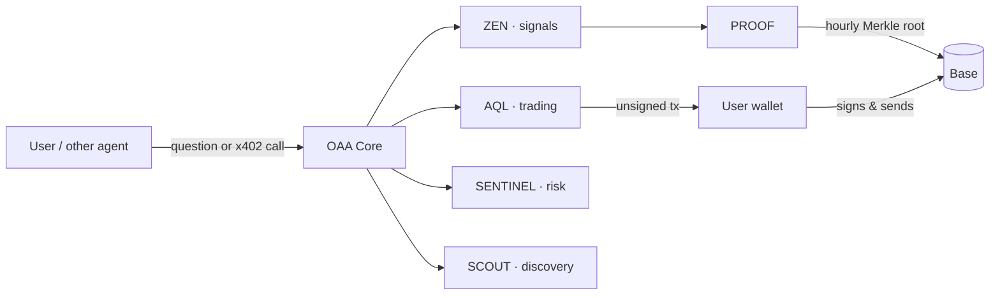

<p align="center">
  
</p>

<p align="center">
  <br>
  <b>OAA Protocol</b> · Orchestrated Autonomous Agents on Base<br>
  <a href="https://oaap.si">Website</a> ·
  <a href="https://x.com/oaaprotocol">X</a> ·
  <a href="https://t.me/oaaprotocol">Telegram</a> ·
  <a href="docs/CHANGELOG.md">Changelog</a>
</p>

---

> **Status: pre-launch.** $OAA launches on **25 November 2026 (00:00 CET)** on Base.
> The official token contract address is published **only** on [oaap.si](https://oaap.si) and our official channels. Anything else is not OAA.

## What is OAA?

OAA is a network of six AI agents that work together. The **OAA Core** takes a request, sends it to the right specialist agents and combines their answers. Every trade is signed by the user in their own wallet. Every ZEN signal is committed on Base before its outcome is known, so anyone can verify the track record.

| Agent | Role | What it does |
|---|---|---|
| **CORE** | Orchestrator | Routes every request to the right agents and writes one combined answer |
| **AQL** | Trading | Live data for any Base token, wallet checks, swaps you sign yourself |
| **ZEN** | Signals | Explainable signals: trend, RSI, MACD, levels, confidence, invalidation |
| **SENTINEL** | Risk | Rug check with a grade A–F and every reason listed |
| **SCOUT** | Discovery | What is moving on Base and the newest OAA launches |
| **PROOF** | Verification | Hourly Merkle batches of all signals and Guardian briefs, anchored on Base |

## Products

- **Agentverse:** chat with the agents, live signal board, rug check, discovery and the x402 marketplace.
- **Portal:** $OAA holder dashboard, OAA Guardian (wallet health, risk grade per token, daily brief), token list, buyback & burn tracker. It switches on automatically at launch.
- **Launchpad (beta after the $OAA launch):** anyone can launch a token on Base. Liquidity is locked **forever** in the launchpad contract, and the creator's first buy is locked for 30 months, then unlocks linearly over 12 months.
- **Buy $OAA with any coin:** pay with ETH, USDC, BNB, BTC or SOL and receive $OAA on Base (cross-chain routing via Relay).

## Launchpad fees

Every token launched on OAA pays **1% per trade**, split on-chain by the contract:

| Share | Goes to |
|---|---|
| 0.4% | Creator of the token |
| 0.3% | Buys $OAA and burns it forever |
| 0.3% | OAA treasury: agents, development, growth |

## x402 marketplace: 23 OAA agent services

Pay per call in USDC on Base, no account needed. Payments go straight to the OAA treasury. Wrong input is rejected before you are charged.

| Agent | Service | Endpoint | Price |
|---|---|---|---|
| CORE | OAA Core | `/x402/core` | $0.25 |
| CORE | Token explained | `/x402/explain` | $0.50 |
| CORE | Market brief | `/x402/brief` | $1.00 |
| CORE | Wallet Guardian report | `/x402/guardian` | $2.00 |
| CORE | Deep due diligence | `/x402/diligence` | $5.00 |
| ZEN | ZEN signal | `/x402/signal` | $0.10 |
| ZEN | ZEN multi-timeframe | `/x402/mtf` | $0.25 |
| ZEN | ZEN compare | `/x402/compare` | $0.40 |
| ZEN | ZEN signal board | `/x402/board` | $0.50 |
| ZEN | ZEN board · top 20 | `/x402/board20` | $1.00 |
| AQL | AQL token check | `/x402/token` | $0.05 |
| AQL | AQL price | `/x402/price` | $0.05 |
| AQL | AQL batch check | `/x402/tokens` | $0.30 |
| AQL | AQL wallet view | `/x402/wallet` | $0.20 |
| AQL | AQL swap quote | `/x402/quote` | $0.15 |
| SCOUT | SCOUT trending on Base | `/x402/trending` | $0.10 |
| SCOUT | SCOUT new OAA launches | `/x402/launches` | $0.10 |
| SCOUT | Trending, risk-checked | `/x402/safetrend` | $1.50 |
| SENTINEL | SENTINEL rug check | `/x402/rugcheck` | $0.15 |
| SENTINEL | SENTINEL batch check | `/x402/rugbatch` | $1.00 |
| SENTINEL | SENTINEL wallet risk | `/x402/walletrisk` | $0.75 |
| PROOF | PROOF track record | `/x402/record` | $0.05 |
| PROOF | PROOF batch data | `/x402/batch` | $0.05 |

The index of all services is served at `/x402` on the OAA worker.

## $OAA tokenomics

Total supply: **1,000,000,000 $OAA**

| Allocation | Share | Tokens |
|---|---|---|
| Liquidity Pool | 70% | 700,000,000 |
| Reserved Liquidity & Treasury (multisig) | 10% | 100,000,000 |
| Ecosystem / Development | 7% | 70,000,000 |
| Marketing / Growth | 7% | 70,000,000 |
| Team | 3% | 30,000,000 |
| Community / Airdrops | 3% | 30,000,000 |

Details and vesting: [docs/TOKENOMICS.md](docs/TOKENOMICS.md).

## Repository

```
contracts/   OAALaunchpad.sol, OAAToken.sol and the launchpad test suite
worker/      the OAA agents (Cloudflare Worker): CORE, AQL, ZEN, SENTINEL, SCOUT, PROOF, x402, buy
website/     the deploy-ready website (oaap.si, hosted on Netlify)
docs/        architecture, tokenomics, x402 and the full changelog
```

## Architecture



More: [docs/ARCHITECTURE.md](docs/ARCHITECTURE.md).

## Security

- The agents **never** hold user funds. Every swap and every payment is signed in the user's own wallet.
- The website never asks for a seed phrase or private key. Access is wallet-only, no personal data is collected.
- No secrets are stored in this repository. All keys live as encrypted variables in Cloudflare.
- Found a vulnerability? See [SECURITY.md](SECURITY.md).

## Disclaimer

OAA is under active development. Nothing here is financial advice. Automatic risk checks are heuristics, not audits. Crypto assets are volatile, only use what you can afford to lose.
